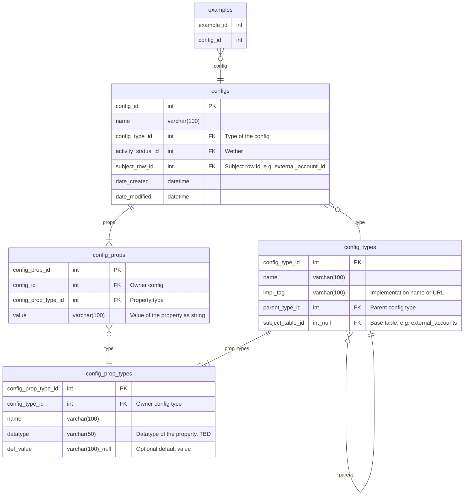

# Configurations 

The schemas for generalized configurations is based on the following tables

- [`configs`](../../procs/messaging/configs.sql)
- [`config_props`](../../procs/messaging/config_props.sql)
- [`config_types`](../../procs/messaging/config_types.sql)
- [`config_prop_types`](../../procs/messaging/config_prop_types.sql)



The diagram above shows the relationships between configs, props and their types, an an example table which uses them. 

There are several design goals for this schema:

1. **Generalized** – Support generalized configuration
2. **Simple** – Prioritize flat configuration over nested configuration for simplicity
3. Support configuration referencing using `parent_type_id` for
   1. Versioning
   2. Tagging
4. Implementation tagging, for example, "@elysiumtg/rw-messagenotifier@0.3.0/messenger", to indicate that the a config type references a specific version required of a package.
5. **Composable**
6. **Ease of Use** – should be easy to use and enter, using flat forms, 

#### Composable

One of the primary goals of this schema is to support composable configurations, to support as much 


## Examples

#### Example: Slack Messenger

In this exmaple, we write a config for a Slack Messenger, which is a configuration type for the `messengers`, able to be consumed by the `@elysiumtg/rw-messagenotifier` package, version 0.3.0. The target configuration needed for this messenger is as follows:

The type definition as consumed by the `@elysiumtg/rw-messagenotifier` package is as follows:

```typescript
export type SlackMessengerConfig = {
  signing_secret: string;
  bot_token: string;
  app_token: string;
  port?: number;
  socket_mode?: boolean;
};
```

An example config definition could look like this:

```json
config = {
  "name": "Slack MPTracker",
  "type": "Slack Messenger",
  "props": {
    "signing_secret": "$ref:sm:{smSecretId}:signing_secret",
    "bot_token": "$ref:sm:{smSecretId}:bot_token",
    "app_token": "$ref:sm:{smSecretId}:app_token",
    "socket_mode": true,
  }
}
```

The following are the corresponding rows in the database:

##### `configs`

| config_id | name              | config_type_id | activity_status_id | subject_row_id |
| --------- | ----------------- | -------------- | ------------------ | -------------- |
| 1         | `Slack MPTracker` | 1              | 1                  | 1              |

##### `config_props`

| config_prop_id | config_id | config_prop_type_id | value                                 |
| -------------- | --------- | ------------------- | ------------------------------------- |
| 1              | 1         | 1                   | `$ref:sm:{smSecretId}:signing_secret` |
| 2              | 1         | 2                   | `$ref:sm:{smSecretId}:bot_token`      |
| 3              | 1         | 3                   | `$ref:sm:{smSecretId}:app_token`      |
| 4              | 1         | 5                   | `true`                                |

##### `config_types`

| config_type_id | name              | impl_tag                                    | parent_type_id | subject_table_id |
| -------------- | ----------------- | ------------------------------------------- | -------------- | ---------------- |
| 1              | `Slack Messenger` | `@elysiumtg/rw-messagenotifier@0.3.0/slack` | NULL           | 1234             |

##### `config_prop_types`

| config_prop_type_id | config_type_id | name             | datatype  | def_value |
| ------------------- | -------------- | ---------------- | --------- | --------- |
| 1                   | 1              | `signing_secret` | `string`  | NULL      |
| 2                   | 1              | `bot_token`      | `string`  | NULL      |
| 3                   | 1              | `app_token`      | `string`  | NULL      |
| 4                   | 1              | `port`           | `number?` | NULL      |
| 5                   | 1              | `socket_mode`    | `bool?`   | true      |

##### `tables`

| table_id | name          |
| -------- | ------------- |
| 1234     | `messengers`  |
